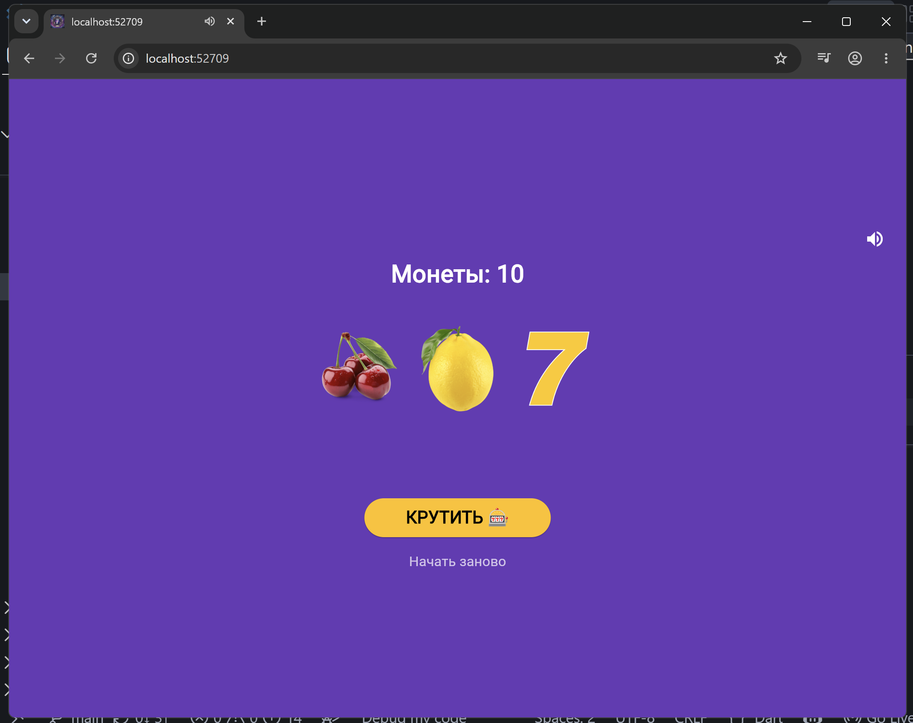
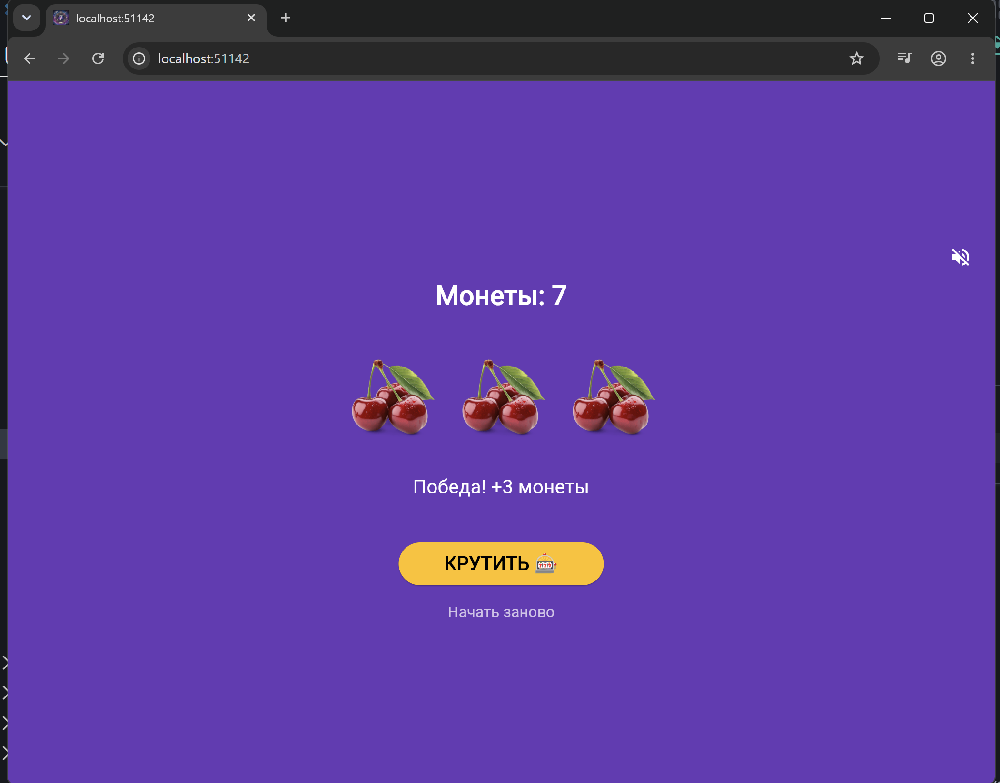
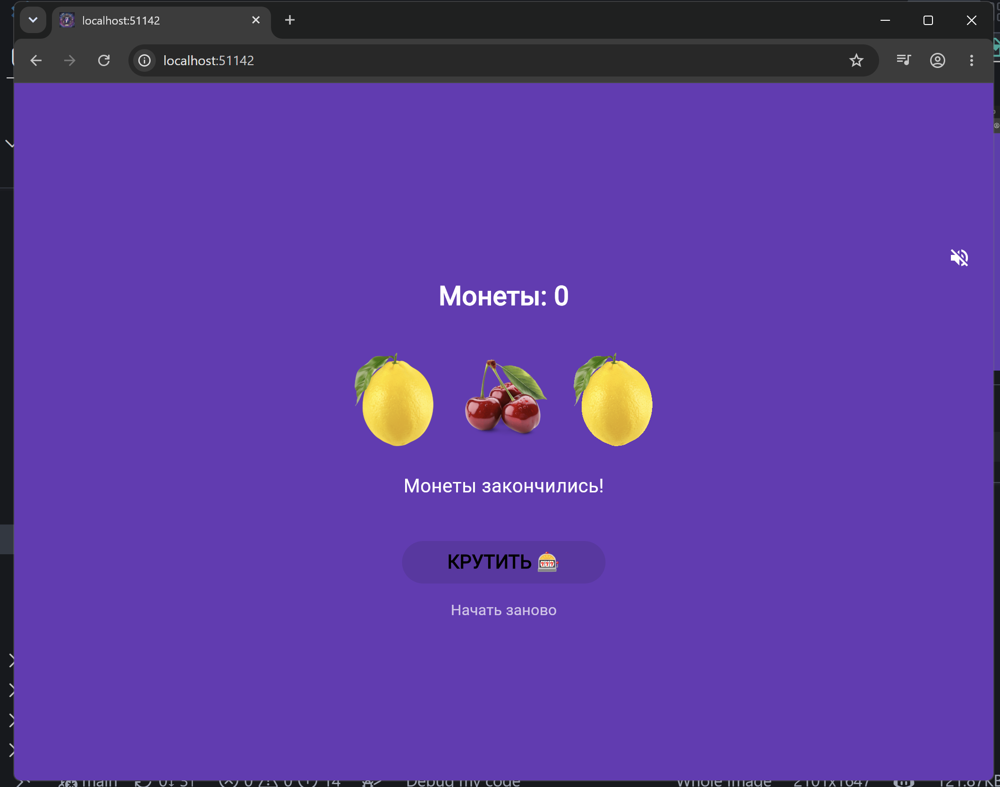

# Учебное приложение. 🎰Слот-машина
___
Простое Flutter-приложение — симулятор казино. Крути барабаны, собирай одинаковые символы и выигрывай монеты!

## 📱Скриншоты 
___
| Главный экран | Победа | Монеты закончились |
| :---: | :---: | :---: |
|  |  |  |

## 💻Как играть
___
* Нажмите **КРУТИТЬ** чтобы запустить барабаны 
* Три одинаковых символа — победа(+3 монеты)
* Три семёрки — джекпот(+10 монет)
* Разные символы — проигрыш(-1 монета)
* Начните заново кнопкой **Начать заново**

## 🚀Запуск проекта 
___
**Требования:** Flutter 3.x, Dart 3.x

```bash
# Клонировать репозиторий
git clone https://github.com/Paltosik92/slot_machine

# Перейти в папку
cd slot_machine

# Установить зависимости
flutter pub get

# Запустить в Chrome
flutter run -d chrome
```

### 📦 Установка на Android
___

Скачайте готовый АРК:
[app-release.apk](https://github.com/ВАШ_ЛОГИН/ВАШ_РЕПОЗИТОРИЙ/releases/download/v1.0/app-release.apk)

## 🛠️Технологии 
___
* **Flutter** 3.41.2
* **Dart** 3.11.0
* Платформы: Web, Android 

## ✍️Что изучено
___
* `StatefulWidget` и управление состоянием через setState()
* Работа с локальными изображениями через `Image.asset()`
* Генерация случайных чисел через `darth:math`
* Анимация через `async/await` и `AnimatedOpacity`
* Сборка под Web

## 👨‍💻Автор
___
**Просвиров Дмитрий**. группа ИСП-241
Лабораторная работа №10, 02.11.2026
